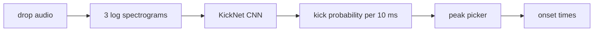

# How the kick model works

tl;dr: audio in, kick timestamps out. A tiny CNN looks at a spectrogram and
says "kick starts here" every 10 ms. That's it. :3



All code lives in `src/services/`.

## 1. Features (`training/features.py`)

- **3 STFTs** with windows of 1024 / 2048 / 4096 samples (23 / 46 / 93 ms),
  all with a 441-sample hop (10 ms). Short window = sharp click timing.
  Long window = clean sub resolution, which is where the kick lives in rawstyle.
  They stack as 3 channels, like RGB but make it audio.
- **Log filterbank:** 109 triangular bands, 30 Hz to 16 kHz, 12 per octave.
- **dB magnitude**, then the model standardizes each band with a mean/std from
  training drops. Those stats live _inside_ the checkpoint, so inference can't
  drift from training. Same feature function for both, no excuses.

## 2. Network (`training/network.py`)

`KickNet`, ~114k weights.

| Block                        | What                                  | Why                                                              |
| ---------------------------- | ------------------------------------- | ---------------------------------------------------------------- |
| 3× Conv2d + BatchNorm + ReLU | 3×7, 3×7, 3×9 kernels (freq × time)   | learn "energy just started in the sub/click band"                |
| MaxPool (3, 1) after each    | pools **frequency only**              | pooling time would eat our 10 ms precision. never.               |
| Dilated Conv1d head          | 5× kernel 3, dilations 1–16, then 1×1 | sees the attack, the tail and the next kick; one logit per frame |

- **Context = exactly ±41 frames (±410 ms)**, and a test enforces it. A bit
  more than one beat at 160 BPM, as in the old model. ±150 ms was too short:
  tonal punches (kloenk, metallic) looked like screech attacks, and the start
  of a kick's tail looked like a new kick. The random kick patterns keep it
  from leaning on a 4/4 grid.
- **Dropout 0.1** after each head layer.
- **Fully convolutional:** one forward pass per drop, one logit per frame.

## 3. Labels + loss

- **Targets:** onset frame = 1.0, the frame on each side = 0.5 (label widening).
  A real onset can land between frames, so we don't punish being 1 frame off.
- **Loss:** BCE with logits, `pos_weight = 5`. Kicks are ~1 in 37 frames, so
  without the weight the model just says "no kick" forever and gets 97% accuracy.
  lazy behavior.
- **Edge mask:** the first and last 41 frames don't see their full context, so
  they don't count in the loss.

## 4. Data

- **Training drops are synthesized on the fly** (`synthesis/`): kicks from the
  bank on a random grid, plus melody/vocal/drum/impact/fx/bass layers,
  sidechain, kick FX, kick gaps, kick rolls (1/8, 1/12, 1/16), and a random
  master chain (tilt, clip, limiter, MP3, gain).
- **Off-beat kicks:** each drop draws an extra 0–30% chance of a 1/8 off-beat
  kick per beat, so some drops gallop and some don't.
- **Sub negatives:** layers are high-passed (melody at a random 60–200 Hz,
  the others at 200 Hz), except impacts and the **bass** layer. Bass hits on
  off-beats and 1/16s teach the model that a sub onset alone is not a kick.
  Every batch is brand new, so there's nothing to memorize.
- **Validation:** 64 fixed drops built only from **held-out kicks** (~10%, picked
  by a hash of the file name). We score on kicks it has never heard.
- **The real exam:** hand-labeled real drops. Synthetic F is a vibe check, not proof.

## 5. Peak picking + scoring (`training/evaluate.py`)

- Sigmoid → probability curve → `scipy.signal.find_peaks` above a threshold,
  ≥ 40 ms apart (a 1/32 at 160 BPM is ~47 ms, so rolls survive).
- Scored with `mir_eval` event matching at **±20 ms**. Validation sweeps
  thresholds 0.10–0.90 and saves the best one in the checkpoint with the weights.

## 6. Training loop (`training/train.py`)

AdamW (lr 1e-3), batch 16, 3000 steps, validate every 250, keep the best F.
Runs on MPS if you have it:

```sh
uv run trainer train -b bank.yaml -o model.pt
```

## Further reading

- J. Schlüter and S. Böck, [Improved musical onset detection with convolutional
  neural networks](http://www.ofai.at/~jan.schlueter/pubs/2014_icassp.pdf),
  ICASSP 2014. **The** blueprint: multi-resolution spectrogram channels, short
  time context, label widening, one probability per frame.
- S. Böck and G. Widmer, [Maximum filter vibrato suppression for onset
  detection](https://www.dafx.de/paper-archive/2013/papers/09.dafx2013_submission_12.pdf),
  DAFx 2013. SuperFlux: the DSP baseline idea and the log-band setup.
- J. P. Bello et al., [A tutorial on onset detection in music
  signals](https://doi.org/10.1109/TSA.2005.851998), IEEE TASLP 2005. Start here
  if onsets are new to you.
- C. Raffel et al., [mir_eval: a transparent implementation of common MIR
  metrics](https://archives.ismir.net/ismir2014/paper/000320.pdf), ISMIR 2014.
  How the F-measure and event matching work.
